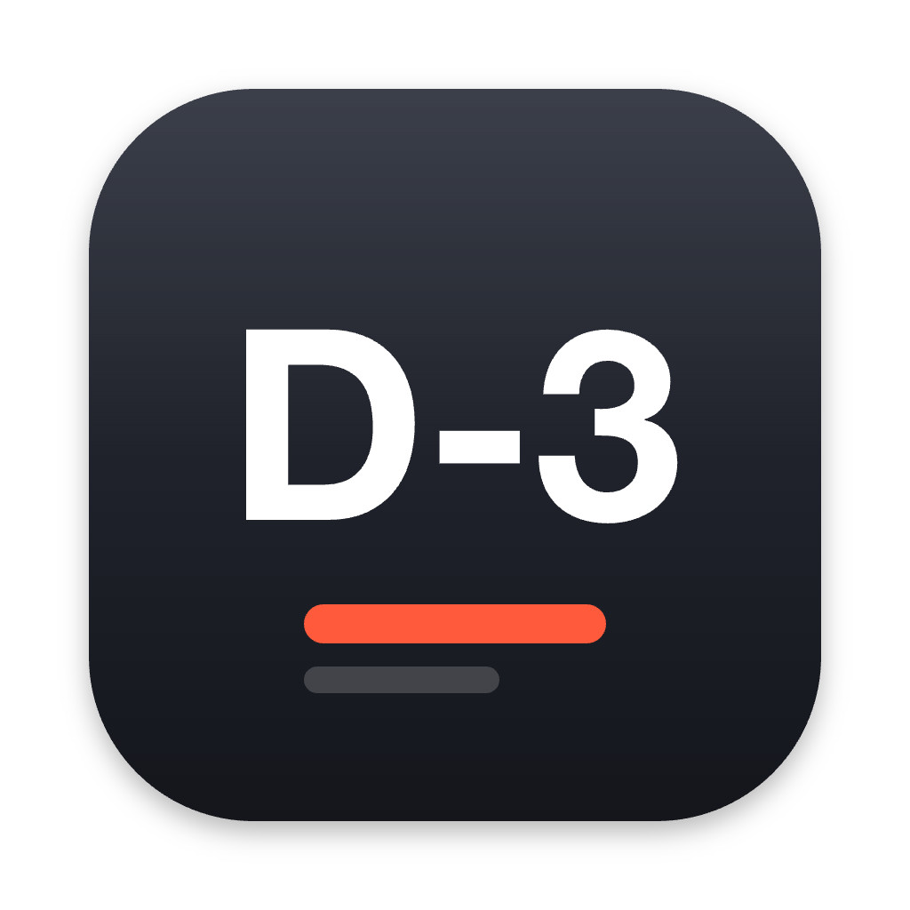
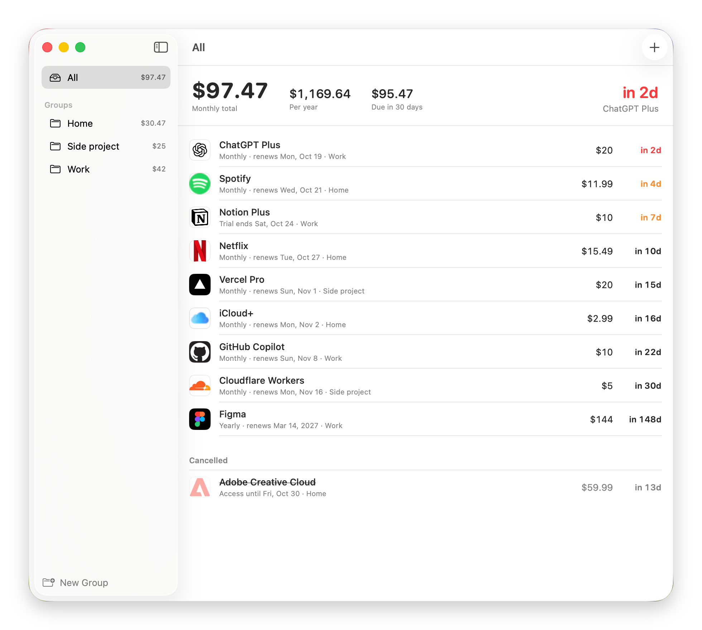
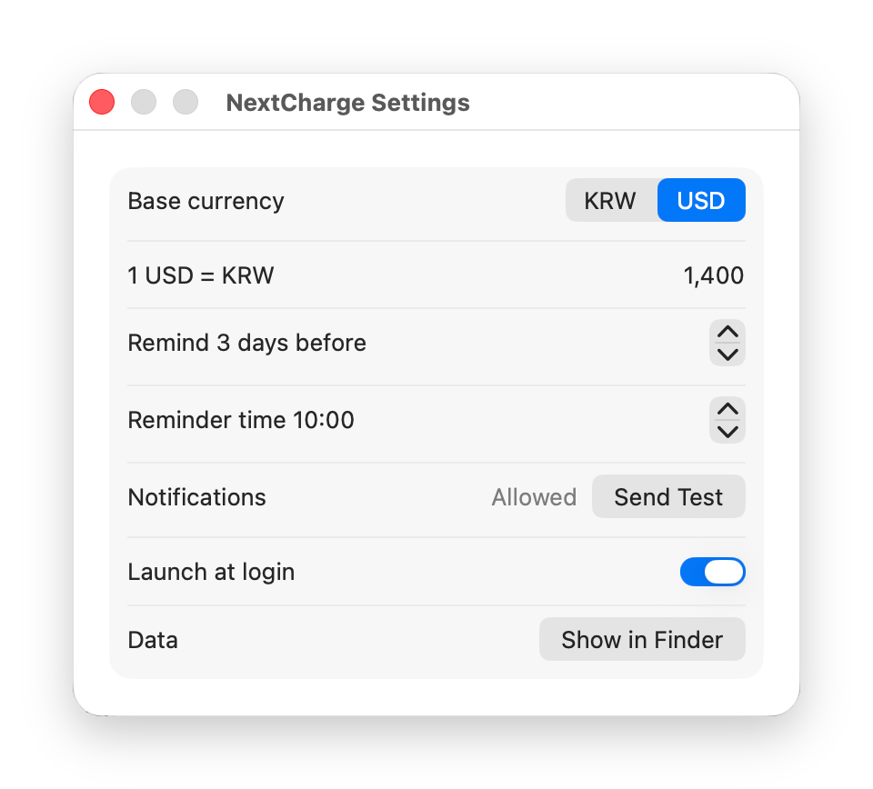

<p align="center">
  
</p>

<h1 align="center">NextCharge</h1>

<p align="center">
  See what your subscriptions cost and when each one charges next. For macOS.
</p>

<p align="center">
  English | <a href="README.ko.md">한국어</a>
</p>

<p align="center">
  <a href="https://github.com/mobrava/NextCharge/releases/latest"></a>
  <a href="https://github.com/mobrava/NextCharge/releases"></a>
  <a href="LICENSE"></a>
  
</p>

<p align="center">
  <a href="https://github.com/mobrava/NextCharge/releases/latest"><strong>Download the DMG</strong></a>
</p>

<p align="center">
  
</p>

NextCharge lists your subscriptions in the order they charge, with a countdown to each one and your monthly total at the top. Put them in groups, and each group shows its own total. It reminds you a few days before a charge and on the day, including when a free trial is about to turn into a paid plan.

It is free, open source, and runs on macOS 14 Sonoma or later. No account, no server, no analytics.

## Install

### Homebrew

```bash
brew install --cask mobrava/tap/nextcharge
```

### Direct download

Download the latest `.dmg` from [Releases](https://github.com/mobrava/NextCharge/releases/latest), open it, and drag NextCharge into Applications. The DMG is signed with an Apple Developer ID and notarized by Apple, so it opens without a security warning.

## Usage

1. Press <kbd>⌘</kbd> <kbd>N</kbd> or the **+** button to add a subscription.
2. Enter the price, the billing cycle, and any billing date: the next one, or one you already paid. NextCharge works out the dates after it.
3. Paste the account or billing page into **Manage page**. The site's logo shows up next to the name, and the right-click menu opens the page.
4. Allow notifications the first time. To check they work, open **Settings** and press **Send Test**.

For a free trial, set the status to **Free trial** and enter the day it ends. Once you cancel something, mark it **Cancelled** with the last day you can use it. It moves to the bottom and leaves the totals.

In the main window:

- Double-click a subscription to edit it
- Right-click to open its manage page, move it to a group, mark it cancelled, or delete it
- Drag subscriptions onto a group in the sidebar to move them, several at a time if you select them first
- <kbd>Delete</kbd> removes the selected subscriptions
- **New Group** at the bottom of the sidebar adds a folder. Right-click a group to rename or delete it. Deleting a group keeps its subscriptions

The menu bar icon shows your monthly total and the next few charges.

## Features

- Subscriptions sorted by next charge, with a countdown that turns orange within a week and red within three days
- Monthly total, yearly total, and what is due in the next 30 days, for everything or for one group
- Groups (folders), each with its own monthly total
- Weekly, monthly, every-3-months, and yearly cycles
- Reminders N days before a charge and on the day, at the hour you pick. Each subscription can follow the default, remind only on the day, use its own number of days, or stay silent
- Free trials and cancelled subscriptions, with their end dates
- KRW or USD as the base currency, with an exchange rate you set
- Site logos fetched from the manage page, or from a domain you enter
- Menu bar summary and launch at login
- English and Korean, following your macOS language
- All data in one JSON file that you, a script, or an AI agent can edit while the app is open

## Screenshots

<p align="center">
  
</p>

## Privacy

Your subscriptions are stored on your Mac in a single JSON file and never leave it. There is no account, no sync, and no analytics.

NextCharge reaches the network for one thing: fetching a logo for the manage page you enter. It requests that site's home page and icon, and falls back to Google's favicon service if the site has none. Logos are saved next to your data, so each one is fetched once. Leave **Manage page** empty and nothing is fetched.

## FAQ

### Do reminders arrive when the app is closed?

Yes. Reminders are scheduled with macOS for the next three charges of each subscription, so they arrive whether or not NextCharge is running. Each launch, and each edit, schedules them again. Open the app once in a while, or turn on **Launch at login**, and they stay ahead.

### Where is my data, and can I edit it directly?

It is in `~/Library/Application Support/NextCharge/subscriptions.json`. NextCharge checks the file every 1.5 seconds, so changes made outside the app show up right away. If the file is not valid JSON, the app keeps the list it has.

```jsonc
{
  "id": "6F1D2C6E-1A0B-4C51-9E2B-0A1E5B7C1001",
  "name": "Netflix",
  "price": 15.49,
  "currency": "USD",            // KRW | USD
  "cycle": "monthly",           // weekly | monthly | quarterly | yearly
  "billingAnchor": "2026-10-27T00:00:00Z", // any billing date; today or earlier counts as paid
  "status": "active",           // active | trial | cancelled
  "endDate": null,              // trial end, or last day of access after cancelling
  "paymentMethod": "",
  "manageURL": "https://www.netflix.com/account",
  "iconDomain": null,           // fetch the logo from this domain instead
  "group": "Home",              // null for no group
  "remindDays": null,           // null = default, 0 = on the day only, -1 = off, N = N days before
  "notes": ""
}
```

To remove everything, quit the app and delete the `NextCharge` folder. To uninstall, drag the app to the Trash as well, or run `brew uninstall --cask nextcharge` if you installed it with Homebrew.

### The wrong logo shows up

The logo comes from the manage page's domain. When that page lives on a payment provider or a different domain, enter the brand's domain in **Logo domain**, for example `slack.com`.

### Can I use a currency other than KRW or USD?

Not yet. Totals are shown in KRW or USD, and the exchange rate between them is the one you enter in Settings.

### Is there iCloud sync or an iPhone app?

No. NextCharge is a Mac app that keeps everything in a local file.

## Build from source

Requires macOS 14 or later and the Xcode Command Line Tools. There is no Xcode project and no dependencies.

```bash
git clone https://github.com/mobrava/NextCharge.git
cd NextCharge
scripts/build-release.sh
open build/NextCharge.app
```

That builds a universal app, signed ad hoc, and a DMG in `build/`. To sign with a Developer ID and notarize:

```bash
SIGN_IDENTITY="Developer ID Application: Your Name (TEAMID)" \
NOTARY_PROFILE=<notarytool keychain profile> \
VERSION=1.3.2 scripts/build-release.sh
```

The app is SwiftUI in four files under `Sources/`. Translations are in `Resources/<language>.lproj/Localizable.strings`, keyed by the English text.

## Motivation

Setting up a side project, I signed up for four paid services in one day and lost track of which one charged when. Subscription trackers exist, but I wanted one that keeps the data in a file I can read and edit, including by asking an AI agent to add or cancel something for me.

## License

NextCharge is available under the [MIT License](LICENSE).
